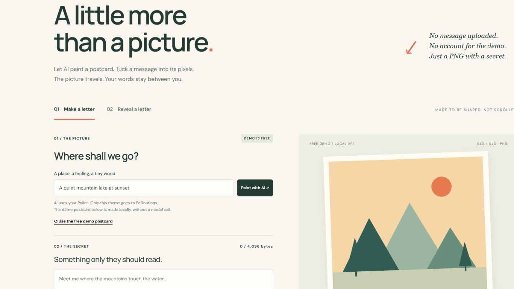

### App Name
Pixel Letter

### App Description
Pollinations LLM-designed PNG postcards with locally hidden messages, optional AES-GCM encryption and OAuth BYOP. Secrets stay on the device; recipients decode without API calls. Includes a free demo.

### App URL
https://pixel-letter-studio.cris16esl.chatgpt.site/

### GitHub Repository URL
https://github.com/CristopherSalazar/pixel-letter-studio

### Screenshot

### App Category
learn

### Platform
web

### App Language
en

### Discord Username
_No response_

### Quest
#18367

### Verification
12 automated tests pass. Real browser PNG download/upload recovered an encrypted Unicode message. Desktop/mobile checks passed. Real OAuth PKCE connection and one openai/gpt-5.4-nano generation succeeded: "Lighthouse at Low Tide", 743 total tokens, under a user-approved 0.01 Quest Pollen session (Paid Pollen disabled). The downloaded AI-generated PNG recovered PIXEL-LETTER-LIVE-20261101 · La luz nos guía 🌊 with verified AES-GCM authentication.

[Live test details and actual PNG](https://github.com/CristopherSalazar/pixel-letter-studio#browser-verification--1-november-2026). This uses PNG pixel steganography rather than SVG metadata; theme-only model prompts keep the secret local. Only explicit Paint with AI actions consume the user’s Pollen; embedding and revealing are free.
