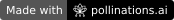

# Pixel Letter

[](https://pollinations.ai/?ref=badge)

AI-designed postcards with messages hidden in the **pixels of a real PNG**, not SVG metadata. Built for [Pollinations quest #18367](https://github.com/pollinations/pollinations/issues/18367).

## Use

1. Connect your Pollen wallet before writing a secret, or start with the free demo.
2. Give Pollinations a visual theme. `openai/gpt-5.4-nano` returns a bounded geometric illustration recipe, rendered with Canvas. Each paid request requires confirmation; there are no automatic retries.
3. Write up to 4,096 UTF-8 bytes. Optionally choose a password. Download the PNG.
4. Send the original as a file. In **Reveal a letter**, select it and enter the password if used. No AI or Pollen is needed to reveal.

**Never resize, convert to JPEG or apply filters.** Messaging/social services may rewrite pixels. This tool reads its own Pixel Letter format, not arbitrary steganography. A message without a password can be read by anyone with this decoder. Hiding is not encryption and is not undetectable.

## Privacy and billing

The secret, password and PNG never go to Pollinations or an app backend. Only the visual theme goes to the model. No analytics. Google Fonts requests load typography; the Pollinations API handles wallet authorization and the requested illustration.

OAuth uses S256 PKCE, state validation, and a public [Client ID Metadata Document](dist/oauth-client.json) supported by Pollinations. No creator secret key is embedded or required. The wallet asks for generation only, one model, a 0.05-Pollen cap and a one-day lifetime; users decide the final restrictions. User tokens live in `sessionStorage` until disconnect/tab close. Disconnect clears the local token; use Pollinations Keys to revoke it server-side. No developer markup or app-key attribution is configured.

Optional encryption uses Web Crypto AES-256-GCM with a random 96-bit nonce, 128-bit salt and PBKDF2-HMAC-SHA256 (210,000 iterations). Unencrypted packets include a SHA-256 integrity checksum. The packet is carried in the least significant RGB bits, leaving alpha untouched. This is an educational tool, not an audited secure messaging system.

## Run and test

Node 22+ and Python 3; no npm runtime dependencies.

```sh
npm test
npm run dev
```

Open `http://localhost:4173`. The local demo/PNG path works offline after the assets load. OAuth requires a public HTTPS deployment with matching `oauth-client.json` identity and redirect URI. The deployed configuration targets the Site declared in `.openai/hosting.json`; self-hosters must change that document to their own public URL.

The tests exercise real encoding/decoding, Unicode, encryption/password failures, damaged payloads, input boundaries, pixel invariants, recipe validation and model request/error handling. API mocks are explicitly tests, not evidence of a live model run.

## Quest submission

The app differs from SVG experiments: deterministic PNG pixel recovery, local-only message processing, optional authenticated encryption, bounded declarative LLM art and no model call needed by the recipient. Submission must include the public source, live URL, screenshot and honest live model evidence. The 7-Pollen quest and catalog reward require maintainer approval; no reward is guaranteed.

## License

MIT — CristopherSalazar. Pollinations badge belongs to its respective authors.
